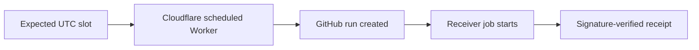
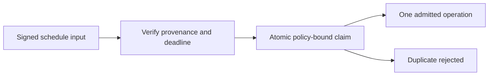
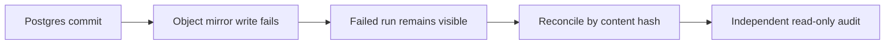

# Backend engineering case studies

## 1. Tracing scheduled delivery to GitHub Actions

The prior hosted observation retained 17 of 168 scheduled pairs. That result
made delivery coverage a prerequisite for another measurement window. A
dedicated, source-free Worker pilot then exposed a runtime fault before any
HTTP dispatch. Workerd rejected the original Fetch redirect mode. The
corrected version made exactly one request to a local mock with GitHub's
required User-Agent and refused redirect responses.

The first live diagnosis observed a scheduled invocation arrive about 53
seconds after the nominal slot, with a reported time that differed from the
exact minute and no GitHub dispatch. A replay in Workerd reproduced a skipped
dispatch for a synthetic timestamp 53 seconds late. The Worker now signs the
nominal minute-17 slot for an event received within the five-minute grace
period. [Live diagnosis](https://github.com/hoangnguyen2003/edgar-moe/actions/runs/45789761599) · [Timestamp fix](https://github.com/hoangnguyen2003/edgar-moe/pull/490)

In the replacement trial's first slot, Cloudflare reported a timestamp 20
seconds after the nominal time. GitHub created the run 23 seconds after that
nominal time, queued the job for 4 seconds, and verified the signature
2 seconds after the job started. This is one verified delivery.
[Cloudflare event](https://github.com/hoangnguyen2003/edgar-moe/actions/runs/45792316354) · [GitHub receipt](https://github.com/hoangnguyen2003/edgar-moe/actions/runs/45799923291)

The pilot report joins GitHub run creation, job start and signed-receipt time
to each expected slot. It reports missing and duplicate slots and excludes
credential setup. Each receipt carries zero hosted read samples. The seven-day
read benchmark and its cache, cold-start and database-resume cohorts remain
part of the separate hosted study. [Prior observation](https://github.com/hoangnguyen2003/edgar-moe/actions/runs/45329321540) · [Runtime fix](https://github.com/hoangnguyen2003/edgar-moe/pull/487) · [Delivery runbook](../ops/private-read-study/README.md#reconcile-delivery-receipts)

## 2. Claiming a scheduled slot once

The prospective runner measures when a forecast was recorded relative to the
next market open. Dispatch can be accepted while its job is still queued.
The offline study claim uses a policy-derived key and the existing
transactional admission ledger. Two connections competing for one timestamp
admit one operation, and the second remains refused after closure. The test
also preserves the deadline when a dispatch arrives early or after its hour.

This evidence covers the offline concurrency contract. The separate forecast
acceptance gate still requires real, pre-open forecasts in a newly reviewed
scope. Ambiguous completion needs reconciliation before any new work is
admitted. [Pre-open margin ADR](adr/0020-pre-open-schedule-margin.md) · [Worker scope](issue-156-replacement-scheduler.md) · [Offline claim](../ops/private-read-admission/README.md#scheduled-observation-claim)

## 3. Recovering when object storage fails after commit

Registry and object storage commit independently. Reconciliation can recover
the object from verified local content and preserves the original failure.
The live isolated rehearsal verifies a second repair stays idempotent. The
separate logical restore checks schema, grants, counts and read availability
against an isolated target. Managed point-in-time recovery requires its own
observed recovery point, elapsed time and verification. [Partial-write drill](https://github.com/hoangnguyen2003/edgar-moe/actions/runs/37217247588) · [Restore drill](https://github.com/hoangnguyen2003/edgar-moe/actions/runs/37207498231) · [Reconciliation runbook](forward-testing.md)
